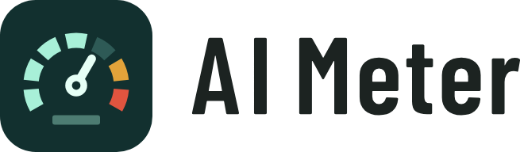
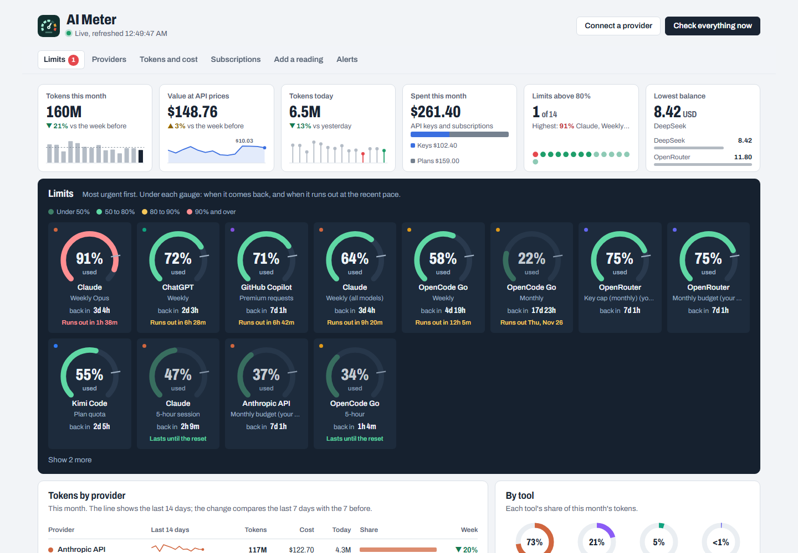
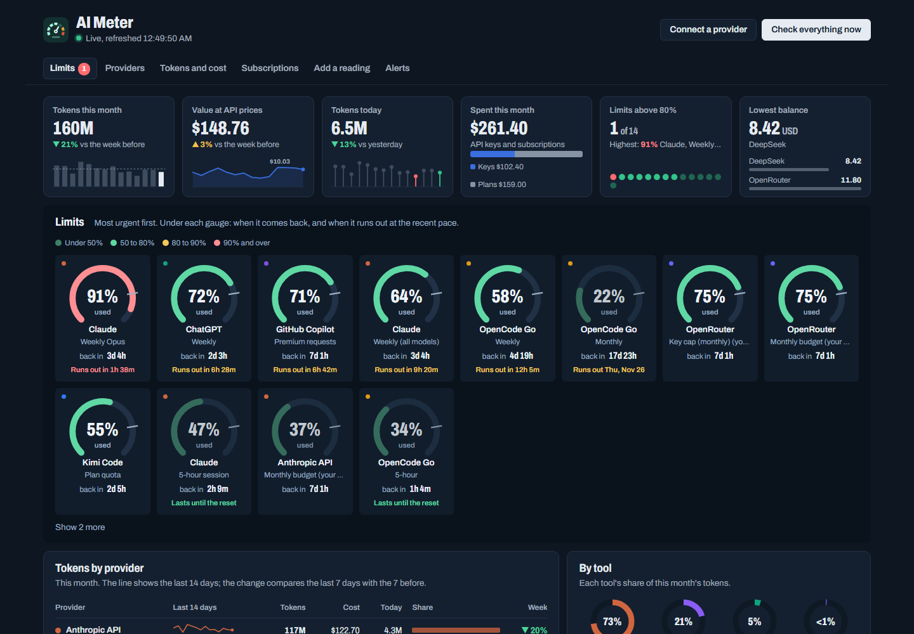
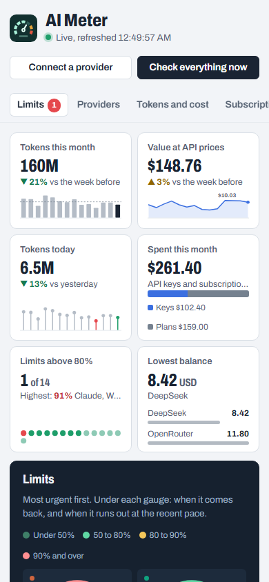

<p align="center"><picture><source media="(prefers-color-scheme: dark)" srcset="brand/logo-dark.png"></picture></p>

<p align="center"><b>Every AI limit, token and dollar, on one screen.</b><br>
Self-hosted, open source, and it runs on your own machine.</p>

<p align="center">
  
  <a href="LICENSE"></a>
  
</p>



If you use several AI tools, each one hides its limits on a different page. AI Meter puts them together: how much of each plan is used, when it comes back, whether it will run out before then, and what you spent.

The numbers in the screenshots are made-up demo data.

## Quick start

You need Python 3.10 or newer.

```bash
git clone https://github.com/eslamelhefny/AImon.git
cd AImon
pip install .
aimeter
```

Open http://localhost:8787 and click **Connect a provider**. Paste a key, or sign in for Claude and ChatGPT. There is no config file to edit.

AI Meter also notices AI tools already installed on your computer and offers to connect them.

## What you get

- **A gauge for every limit.** 5-hour, weekly and monthly limits, most urgent first, with live countdowns to the reset.
- **A run-out forecast.** Each limit says when it runs out at the pace of the last 6 hours, or that it lasts until the reset.
- **Tokens and cost.** Today, this month, per provider, per model and per tool, with 14-day trends and week-on-week change. Overlapping sources are counted once.
- **Real money kept apart from estimates.** "Spent" is what you paid. "Value at API prices" is what the same tokens would cost through an API.
- **Usage from local logs.** Tokens from Claude Code, Codex, Qwen Code, DeepSeek Harness and Continue, with no key needed.
- **Alerts.** Telegram or any webhook, at 50, 80 and 95%.
- **In your editor.** The VS Code extension shows the tightest limit in the status bar and every limit in a side panel.

<details>
<summary>Dark theme and phone</summary>





</details>

## Providers and tools

| Source | What it shows | Connect with |
|---|---|---|
| Claude Pro/Max | 5-hour and weekly limits, reset times | Sign in |
| ChatGPT / Codex | 5-hour and weekly limits | Sign in, or Codex logs |
| GitHub Copilot | Premium requests, monthly reset | GitHub token |
| Kimi Code | 5-hour window, plan quota | API key |
| OpenCode Go | 5-hour, weekly and monthly allowance | API key |
| OpenRouter | Credits, key cap, tokens per model | API key (management key for tokens) |
| DeepSeek, Kimi API | Prepaid balance, spend worked out from balance drops | API key |
| Anthropic, OpenAI spend | Monthly spend, tokens per model | Admin key |
| Anthropic, OpenAI rate limits | Tokens and requests per minute | API key |
| Nous Portal | Rate limits, when Nous reports them | API key |
| Hermes Agent | Tokens and cost of everything it runs | Path to its `state.db` |
| Coding tools on this computer | Tokens from Claude Code, Codex, Qwen Code, DeepSeek Harness and Continue | Nothing, reads local logs |
| Local models | What Ollama and LM Studio have installed and loaded | Nothing |
| Anything else | Readings you add by hand | Nothing |

Claude, ChatGPT, Kimi Code and OpenCode Go are read from the same usage endpoints their own apps use. Those are not documented public APIs and may change. When one does, its card shows an error rather than a wrong number.

## Privacy and security

- AI Meter has no account, no cloud service and no telemetry. It contacts the providers you connect, plus the alert channels you turn on. The page loads its fonts from Google Fonts.
- Keys stay in a local database (or environment variables) and are never sent to the browser or the editor.
- Local logs are read only, and only counts, costs, model names, times and limits are kept, never prompts or replies.
- Without a dashboard token, it answers only on local host names. Changes must come from the page itself (protection against CSRF and DNS rebinding).

## Commands and options

```bash
aimeter                                    # start the dashboard
aimeter status                             # summary in the terminal
aimeter collect --force                    # check every provider now
aimeter serve --host 0.0.0.0 --port 8787   # share on your network (set AIMETER_DASHBOARD_TOKEN first)
aimeter-desktop                            # open in its own app window
AIMETER_HOME=/srv/aimeter aimeter          # keep config and data elsewhere (default ~/.aimeter)
```

Codex can compress older logs as `.zst`. To read those too: `pip install zstandard`.

## Other ways to run it

**Docker on a server**

```bash
cd docker && docker compose up -d --build
```

Config and data live in `/opt/aimeter` on the host. The dashboard listens on `127.0.0.1:8787`; reach it with an SSH tunnel: `ssh -N -L 8787:127.0.0.1:8787 you@your-server`. See [docs/vps.md](docs/vps.md) for a Hostinger VPS.

**VS Code**

Build the extension with `scripts/build_vscode.sh`, then choose **Extensions: Install from VSIX** in VS Code. It reads from your running AI Meter; if you set a dashboard token, run **AI Meter: Set dashboard token** once.

**Windows app**

`scripts/build_windows.sh` builds `AI-Meter-Windows.zip`. Unzip it and double-click **AI Meter.exe**. It opens in its own window and needs no Python. It is experimental: it has not been tested on many Windows computers yet.

## Development

```bash
pip install -e . pytest
python -m pytest              # offline, providers are faked
python tests/serve_demo.py    # demo data at http://localhost:8800/?token=demo
```

| Folder | What it is |
|---|---|
| `src/ai_meter/` | The app: `cli.py` (collectors, storage, web server), `dashboard.html`, `desktop.py` |
| `docker/`, `deploy/` | Docker files and systemd units |
| `vscode-extension/` | The VS Code extension |
| `windows/` | Source for `AI Meter.exe` |
| `scripts/` | Build scripts for every release file |
| `brand/` | Logo and icons |
| `tests/` | Tests, demo and screenshot checks |

The backend is one Python file (standard library, requests and PyYAML). The page is one HTML file with no build step. See the [changelog](CHANGELOG.md) for what changed.

Bug reports are welcome, especially "this provider's endpoint moved": please include the error on its card, never your keys.

## License

[MIT](LICENSE). AI Meter is an independent project and is not affiliated with the providers it reads from.
